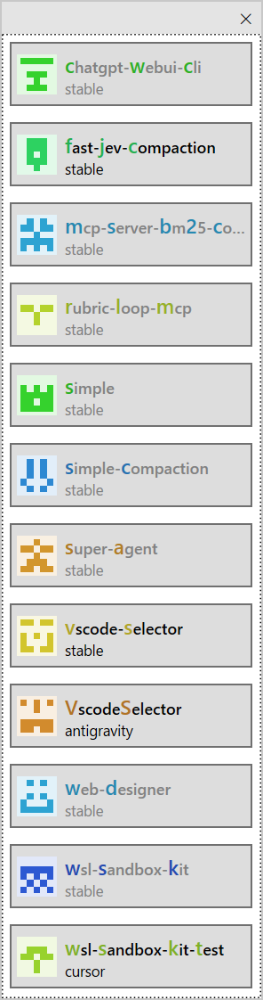
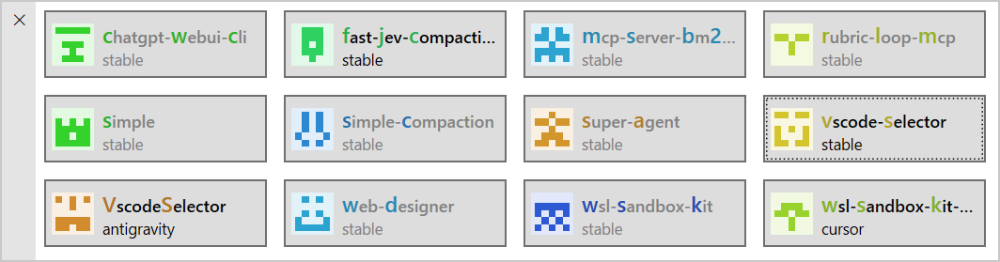
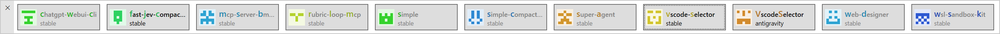

# VscodeSelector

[日本語](README.ja.md)

A small Windows tool that lists every open VS Code window as a button labeled with its project name. Click a button to bring that window to the front.

| Vertical | Grid |
|---|---|
|  |  |



## Features

- Detects VS Code, VS Code Insiders, VSCodium, Cursor and Antigravity IDE windows
- Shows the project name parsed from the window title, plus the edition and remote type (e.g. `stable / wsl: ubuntu`)
- Per-project identicon and highlighted word initials so similar names are easy to tell apart
- Click the button of the window that is already in front to minimize it (toggle)
- Same-name projects are disambiguated by remote label, edition, then `#N`
- Frameless, resizable window; the drag bar moves to the short side (left when wide, top when tall)
- Window position and size are remembered across launches
- Keyboard: `Ctrl+1`–`Ctrl+9` activate the N-th button, `Enter` activates the focused one, `Esc` minimizes the selector

## Requirements

- Windows 10 / 11 (x64)
- [.NET 8 Desktop Runtime](https://dotnet.microsoft.com/download/dotnet/8.0)

## Install

Download [`src/VscodeSelector/bin/publish-fd/VscodeSelector.exe`](src/VscodeSelector/bin/publish-fd/VscodeSelector.exe) and run it. No installer is needed.

## Build

```sh
dotnet build src/VscodeSelector -c Release
dotnet test tests/VscodeSelector.Tests

# single-file, framework-dependent exe
dotnet publish src/VscodeSelector -c Release -r win-x64 --self-contained false -p:PublishSingleFile=true -o src/VscodeSelector/bin/publish-fd
```

## Settings

Optional. `%APPDATA%\VsCodeSelector\settings.json` (comments and trailing commas allowed). Missing or invalid keys fall back to defaults.

| Key | Type | Default | Description |
|---|---|---|---|
| `titleSeparators` | string[] | `[" - "]` | Separators used to split the window title |
| `titlePattern` | string / null | `null` | Regex with a named group `project` |
| `extraProcessNames` | string[] | `[]` | Additional exe names treated as VS Code |
| `sortOrder` | `"name"` / `"zorder"` | `"name"` | Button order |
| `topmost` | bool | `false` | Keep the selector always on top |
| `hideOnActivate` | bool | `false` | Minimize the selector after activating a window |

Logs are written to `%LOCALAPPDATA%\VsCodeSelector\logs\`.

## License

[MIT](LICENSE)
